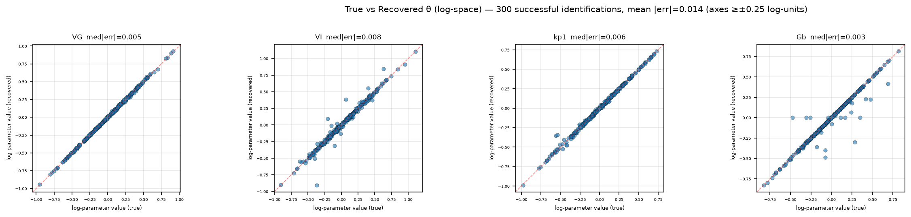
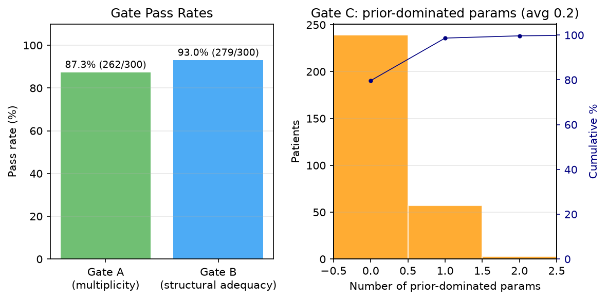
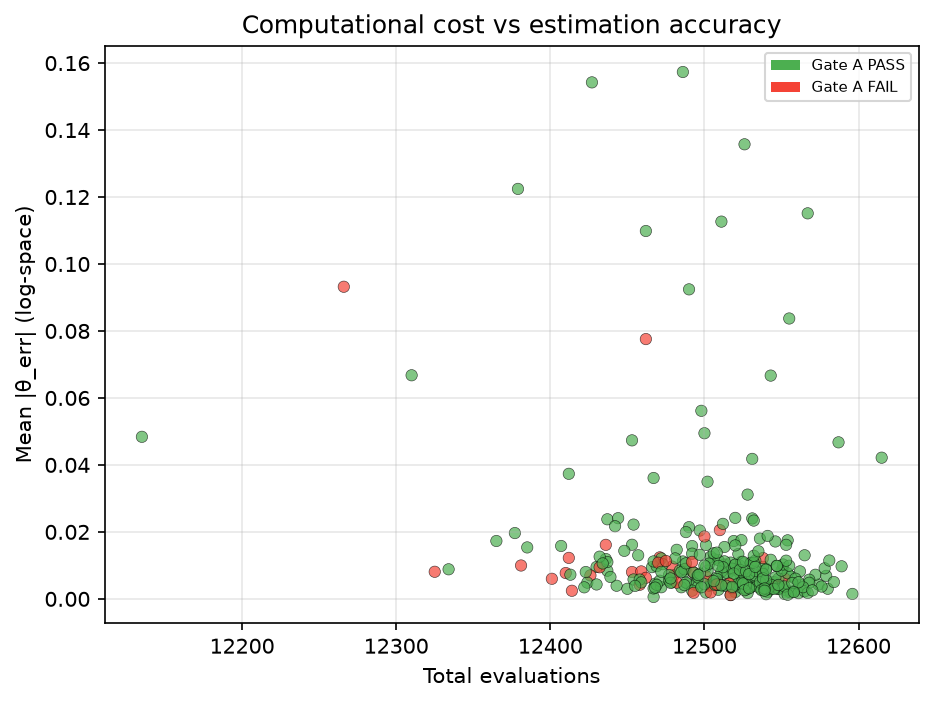

# UVA-Padova Glucose Control System

[](LICENSE) [](https://github.com/1paulpo1/uva-padova-glucose-control-system/actions)

Personalized glucose prediction from the UVA-Padova model (Dalla Man
2007/2013). The question I worked on: how much of the model can actually be
identified from a single CGM channel — dinner logs, insulin pump data, and a
glucose trace, nothing invasive. Answer so far: a small core
(`VG, VI, kp1, Gb`) recovers cleanly; beyond that the data runs out, and the
repo documents exactly where.

Offline identification is CMA-ES followed by Levenberg-Marquardt, with three
diagnostic gates (restart consensus, residual structure, prior-dominated
directions). Online CKF adaptation compiles and runs but has no real-data
validation; there is no MPC controller. Details in [docs/STATUS.md](docs/STATUS.md).

Full math spec (in Russian): [docs/main.md](docs/main.md). There is also a
draft for a larger gut-hormone model I did not build: [docs/new.md](docs/new.md).

---

## Quick start (no real data needed)

```bash
# 1) Build
cmake --preset release  # or: cmake -B build -DCMAKE_BUILD_TYPE=Release && cmake --build build -j
ctest --test-dir build --output-on-failure

# 2) Synthetic recovery — 1 virtual patient, 1 day
./build/synthetic_study/cross_validate --patients 1 --seed 42 --restarts 3 --evals 200 --noise-preset cgm --csv /tmp/synth.csv --json /tmp/synth.json
python3 synthetic_study/analyze_results.py --json /tmp/synth.json --out /tmp/figs --no-plots
cat /tmp/synth.json | python3 -m json.tool | head -n 50
```

Takes a few minutes. CMA-ES itself is seconds; almost all the time is LM
refinement, which converges in ~6 iterations on a good start and grinds
longer on a bad one. The worked example with measured numbers is
`examples/complex_irregular_patient/` (47 s for 25×500 on the 4-param core).

```bash
# 3) Real-world validation — needs T1DEXI/OhioT1DM parquet, download it first
export UVA_PADOVA_PARQUET=~/Downloads/metabonet_public.parquet
python3 real_world_validation/run_validation.py --study Loop --max-patients 5 --evals 200 --verbose
```

---

## What works and what does not

| Area | State |
|---|---|
| 14-state T1D model (`types.hpp:56`, `odesystem.hpp:20`) | done, unit-tested |
| Structural identifiability (`real_world_validation/identifiability/`) | done (Julia + committed CSVs) |
| Offline CMA-ES→LM, per-element SoftL1, sandwich covariance (`cost_function.hpp:97`, `optimizer_impl.hpp:50`) | done, checked on 300-patient sweeps |
| Gates A/B/C (`diagnostics.cpp`) | done |
| CKF / RTS / meal-priors (`cubature_kalman_filter.hpp:60`, `online_adaptation.hpp`) | compiles, runs; no real-data loop test |
| MPC controller | missing |

Not a medical device. Nothing here should inform dosing decisions.

---

## Project structure

```
include/uva_padova/          # core model + identification + online (header-only online)
src/                         # types, odesystem, integrals, diagnostics, optimizer
config/                      # parameter descriptors (5-active default, 9-active benchmark, scenarios)
real_world_validation/       # real CGM (T1DEXI/OhioT1DM) — offline ID + Gates A/B/C
  parsers/                   # parquet → CSV (pyarrow)
  identifiability/           # StructuralIdentifiability.jl studies
synthetic_study/             # virtual patients — recovery/observability study
  virtual_patient.{hpp,cpp}  # perturbation + error models
  cross_validate.cpp         # sweep runner
  online_evaluate.cpp        # CKF horizon study (not validated)
tests/                       # unit / integration / recovery
docs/main.md                 # full spec (RU)
docs/STATUS.md               # scope: done vs missing
docs/TERMINOLOGY.md          # why folders are named this way
```

The folder names changed in September 2026: what used to be `validation/`
is `real_world_validation/` (real CGM), what used to be `crossval/` is
`synthetic_study/` (virtual patients generated by the simulator itself).
Rationale in [docs/TERMINOLOGY.md](docs/TERMINOLOGY.md).

---

## Results

Reference sweep: 300 virtual patients, 1 day each, identifiable core of
4 params (`VG, VI, kp1, Gb`), 25 CMA-ES restarts × 500 evals + LM.
Raw output is megabytes of JSON and lives outside git; the three figures
below are the curated exception (`docs/figures/`, regenerable with
`python3 synthetic_study/analyze_results.py --json <sweep>.json --out docs/figures
--plot true_vs_recovered,gate_summary,evals_vs_accuracy`).



All four params sit on the diagonal — median |err| `Gb` 0.003, `VG` 0.005,
`kp1` 0.006, `VI` 0.008 (under 1% in physical units). Axes are floored at
±0.25 log-units so closeness to the diagonal reads against a fixed scale,
not matplotlib autoscale.



Gate A (restart consensus) passes 262/300; gate B (residual structure)
279/300, with only 1 patient failing both. Gate C averages 0.2
prior-dominated params per patient (239/300 fully clean; `VI` flagged most
often — insulin kinetics from glucose alone is the weakest link of the
four).



Each dot is a patient at a fixed budget (~12.5k evaluations). Errors
cluster below 0.02 with isolated outliers; red gate-A failures sit at low
errors too — on this well-observed set, gate passage barely separates
accuracy, i.e. the gates read conservative rather than optimistic.

Beyond the reference sweep, `examples/complex_irregular_patient/` is a
worked single-patient case (irregular meals + correction boluses): the
4-param core (`VG/VI/kp1/Gb`, 25 restarts) passes all gates with mean error
≈ 0.02, while the 15-param set fails gate A with 8/16 dominated. Run it
with `./examples/complex_irregular_patient/run.sh`, bulk statistics with
`run_stats.sh 100 123`.

Where run outputs live: scripts write JSON/CSV/PNG next to themselves or to
`/tmp`; none of that is committed — only code, configs, docs, and the three
reference figures above are.

---

## Reproducibility

- C++ dependencies: Eigen3, Ceres, libcmaes, nlohmann/json, GTest, Boost
  (Ljung-Box). No hard-coded Homebrew paths; plain `find_package`.
- Python: `pip install -r real_world_validation/requirements.txt`
  (numpy + matplotlib cover the core plots; sklearn/statsmodels are
  optional and fail per-plot, not per-run).
- Data: the real-data parquet is downloaded separately
  (`UVA_PADOVA_PARQUET`); synthetic runs need nothing.
- CI builds Ubuntu + macOS, runs ctest and a 1-patient smoke run.

Open issues and plans: [ROADMAP.md](ROADMAP.md).

---

## Citation

Dalla Man C. et al. 2007/2014/2018 for the model; for this code see
[CITATION.cff](CITATION.cff).

## License

MIT — see [LICENSE](LICENSE).
